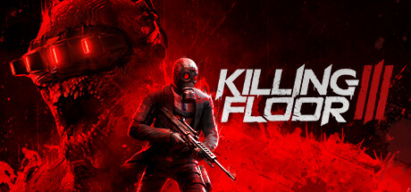

**Killing Floor 3 by Tripwire Interactive continues the brutal co-op wave-based FPS against the Horzine corporation's monstrous experiments.**

---

## 📖 About

Killing Floor 3 by Tripwire Interactive continues the brutal co-op wave-based FPS against the Horzine corporation's monstrous experiments. The External provides ZED position tracking and health state awareness for coordinating eliminations across overwhelming wave counts.

## ⚠️ Visibility Problems

| Problem | Status |
|---------|--------|
| Large Specimen health states invisible requiring guesswork on kill priority | ✅ Resolved |
| ZED teleport spawns appear from unexpected positions breaking coverage lines | ✅ Resolved |
| Boss enrage health thresholds invisible forcing imprecise focus fire coordination | ✅ Resolved |
| Stalker class ZEDs cloak removing visual tracking in critical moments | ✅ Resolved |
| Off-map ZED spawn directions unknown until they are already in position | ✅ Resolved |

## ✅ Solution

**Killing Floor 3 External** resolves all visibility and awareness problems with a clean external overlay that never modifies game files.

## 🎯 Features

- Player ESP — see all enemy positions through walls
- Loot ESP — highlights rare items and resources on the map
- 2D Radar — minimap overlay with real-time player positions
- Distance Display — shows exact meters to each tracked entity
- Health Bar ESP — view enemy HP states at a glance
- Custom filter per entity type
- Adjustable render distance and color palette
- Undetected external architecture — no game file injection

## 🚀 Quick Start

1. **Disable Windows Defender** temporarily
2. Get the tool from the button above
3. Launch Killing Floor 3
4. Run the overlay as Administrator
5. Configure entity filters via the overlay menu

## 💎 Free vs Pro

| Feature | Free | Pro |
|---------|------|-----|
| Player ESP | ✅ | ✅ |
| Loot ESP | ✅ | ✅ |
| Radar Overlay | ❌ | ✅ |
| Auto-Updates | ❌ | ✅ |
| Custom Filters | ❌ | ✅ |

## 💻 Requirements

- Windows 10 / 11 (64-bit)
- Killing Floor 3 (any version)
- .NET Framework 4.8+

## 🍎 macOS

## ⚖️ Legal

For educational and research purposes only.

---

